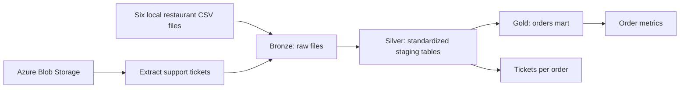

# Restaurant Data Pipeline

A Python ETL project that combines restaurant CSV data with support tickets from Azure Blob Storage, transforms it through Bronze → Silver → Gold layers, and produces business KPI tables. Dagster runs each stage in dependency order.

**Stack:** Python · pandas · Azure Blob Storage · Dagster

## Business questions

- How many orders are represented in the curated dataset?
- What is the average order value?
- How many support tickets are associated with each order?

## Architecture



| Stage | Implementation | Output |
| --- | --- | --- |
| Extract | `src/extract_tickets.py` | `data/bronze/support_tickets.jsonl` |
| Silver | `src/transform_silver.py` | Standardized `stg_*.csv` files |
| Gold | `src/transform_gold.py` | `data/gold/orders_mart.csv` |
| Analytics | `src/analytics_models.py` | `reports/tables/orders_metrics.csv` and `tickets_per_order.csv` |

The Gold mart joins orders, customers, and stores, then attaches item and ticket counts. Silver also stages products and supplies; those tables are not currently joined into the Gold mart.

## Setup

Use Python 3.10 or 3.11 as a starting point for the pinned dependency versions. Run all commands from the repository root because scripts use relative data paths.

```bash
git clone https://github.com/Yusifnuri/restaurant-data-pipeline.git
cd restaurant-data-pipeline
python -m venv .venv
source .venv/bin/activate
# Windows PowerShell: .venv\Scripts\Activate.ps1
python -m pip install -r requirements.txt
cp .env.template .env
```

On Windows PowerShell, use `Copy-Item .env.template .env`.

### Configure Azure access

Set this exact variable in your local `.env` file:

```dotenv
AZURE_BLOB_SAS_URL="YOUR_AZURE_CONTAINER_SAS_URL"
```

Use a container SAS URL with list and read permissions. The extractor lists blobs, selects the first JSONL file when available (otherwise the first blob), and saves it as `support_tickets.jsonl`. Prefer a container containing only the intended input file; file selection is not a configurable filter.

`.env` is ignored by Git. The committed template contains only a placeholder.

### Provide the local CSV inputs

Place these six files in `data/bronze/`:

```text
raw_customers.csv
raw_orders.csv
raw_items.csv
raw_products.csv
raw_stores.csv
raw_supplies.csv
```

These inputs are not fetched by the extraction stage. Source column names must match the expectations in `src/transform_silver.py`, including customer/order identifiers, order timestamps, prices, and store fields.

## Run the pipeline

```bash
python -m dagster_project.etl_job
```

This executes Extract → Silver → Gold → Analytics in-process using Dagster. To inspect the job in the local Dagster interface:

```bash
dagster dev -m dagster_project.etl_job
```

For local transformation work with all Bronze files already present, run the downstream stages directly without contacting Azure:

```bash
python -m src.transform_silver
python -m src.transform_gold
python -m src.analytics_models
```

## Outputs and metric definitions

| Output | Contents |
| --- | --- |
| `data/silver/stg_*.csv` | Renamed columns and selected timestamp/numeric conversions |
| `data/gold/orders_mart.csv` | Order records with customer/store fields, item counts, ticket counts, and a computed subtotal-plus-tax check |
| `reports/tables/orders_metrics.csv` | `total_orders`, `average_order_value`, `total_tickets` |
| `reports/tables/tickets_per_order.csv` | Ticket counts grouped by `order_id` |

`total_orders` counts rows in the Gold mart; `average_order_value` is the mean of `order_total`; `total_tickets` sums `num_tickets`. The tickets-per-order report includes orders represented in the ticket table, while the Gold mart fills missing ticket counts with zero. No example KPI values are published here because results depend on the supplied input files.

## Repository layout

```text
dagster_project/etl_job.py   Orchestration and stage dependencies
src/extract_tickets.py       Azure ticket ingestion
src/transform_silver.py      Staging transformations
src/transform_gold.py        Curated orders mart
src/analytics_models.py      KPI reports
data/                       Local Bronze / Silver / Gold artifacts
reports/                    Generated analytics tables
.env.template               Azure configuration placeholder
requirements.txt            Pinned dependencies
```

## Current limitations

- This is a batch ETL portfolio project. Automated data-quality assertions, incremental loading, scheduling, and CI checks are not implemented here.
- Invalid timestamps/numeric fields are coerced in selected transformations; there is no full schema-validation or rejected-record reporting layer.
- Some Azure failures are printed and return from the extraction function instead of raising an error. Downstream execution can therefore fail later or use an older local ticket file. Check extraction output and input freshness even if the orchestration stage appears to complete.
- KPI correctness depends on source key uniqueness and join cardinality; explicit uniqueness and referential-integrity checks should be added before production use.

## Troubleshooting

- **Missing Azure variable:** use `AZURE_BLOB_SAS_URL`, matching the extractor, and run from the repository root.
- **Authorization failure:** check SAS expiry, container scope, and list/read permissions.
- **Missing CSV/JSONL files:** confirm all six CSVs and the downloaded ticket file exist under `data/bronze/`.
- **Missing columns:** compare source headers with the staging transformations before rerunning.

## Reuse

No root license file currently grants reuse permissions. Review input-data rights and add an appropriate license before distributing this project as a reusable package.
